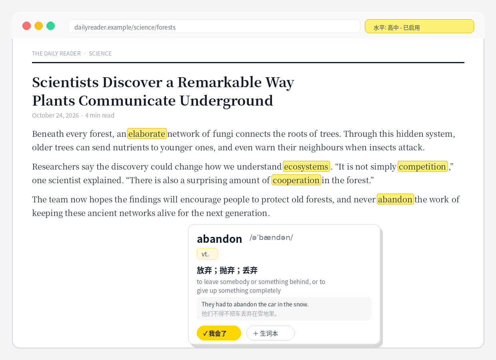

# Vocab Highlighter · 英语生词高亮助手

[简体中文](README.md) | **English**


> Highlights unfamiliar English words on any webpage based on your English level. Hover for phonetics and definitions. If you never look a word up, the extension assumes you already know it — and stops highlighting it.

The biggest interruption when reading in English isn't a page you can't understand at all — it's stopping again and again to look words up. This extension does one small thing: **it only flags the words you probably don't know, and it learns more about you the longer you use it.**

## 📸 Demo



*Words above the selected level (Senior High in this demo) are highlighted; hovering `abandon` shows its phonetics, Chinese definition, and an example sentence. This is an illustrative demo image — live definitions are returned by DeepSeek in real time.*

---

## ✨ Features

- **Level-based highlighting** — Pick your level from a dropdown (Primary School / Junior High / Senior High / CET-4 / CET-6 / Postgraduate & TEM-8). Only words above your level are highlighted in yellow
- **Hover definitions** — Hover a highlighted word to see a card with phonetics, part of speech, a Chinese definition, an English definition, and an example sentence with translation
- **Selection explanations** — Select a word, phrase, or sentence on any page and click the "✦ Explain selection" button for a Chinese translation, a structure breakdown, and key-word definitions (a single word goes straight to the dictionary result)
- **Flexible API configuration** — Base URL, model, and API key are all editable in the options page: DeepSeek by default, or any OpenAI-compatible API (OpenAI, SiliconFlow, Kimi, Tongyi, local compatible servers). Enter a base URL, or a full `/chat/completions` URL — both are normalized automatically
- **Implicit learning (core idea)** — If a highlighted word keeps appearing across different pages and you never hover it, the extension infers that you actually know it, marks it as "learned", and stops flagging it
- **Vocabulary book** — Add genuinely unfamiliar words to your vocab book in one click; they stay highlighted until you manually mark them as known
- **Local caching** — Looked-up words are cached locally, so repeat hovers don't call the API again or cost you again
- **Privacy-first** — No server, no tracking. Your level, vocab book, learned words, and API key live only in your browser's local storage

## 🧠 How does it decide that you "know" a word?

```
A word is highlighted
  ├─ You hover and read the definition ──→ Assumed not yet known; keeps highlighting
  │    ├─ Click "✓ I know this" ─────────→ Marked as learned immediately; highlight removed
  │    └─ Click "+ Vocab book" ──────────→ Keeps highlighting until you mark it as known
  │
  └─ You don't look it up (on one page) ─→ Observation count +1 (counted per distinct page;
  │                                          refreshing the same page doesn't count twice)
       └─ Count reaches the threshold (default: 3 distinct pages)
                                          ─→ Automatically marked as learned; no longer highlighted
```

The threshold is adjustable in the popup (1–6). This design avoids two kinds of mistakes: a word repeated many times in a single article won't make it "learned" on that article alone, and skipping a word once won't instantly count as mastery either.

## 🚀 Quick Start

### Installation (load unpacked)

1. Download this repository (`git clone`, or download the ZIP and unzip it)
2. Open your browser's extensions page:
   - Chrome: `chrome://extensions`
   - Edge: `edge://extensions`
3. Turn on **Developer mode** (top right)
4. Click **Load unpacked** and select this project folder
5. Click the extension icon, choose your English level from the dropdown, then refresh any English webpage

> A Chrome Web Store listing is not available yet; a store link will be added after the open-source release.

### DeepSeek API setup (recommended)

The extension works without an API key (via a free dictionary: phonetics + English definitions only), but **Chinese definitions require DeepSeek**:

1. Sign up at [platform.deepseek.com](https://platform.deepseek.com), then create a key under **API Keys**
2. Click the extension icon → **Set DeepSeek API Key / Manage word lists**
3. Paste your `sk-...` key, save it, and click **Test lookup** to verify
4. Go back to any English page and hover a highlighted word

Lookups are cheap (a fraction of a cent each), and results are cached locally — the same word is never billed twice.

## ⚙️ Levels

| Level | Assumed vocabulary | Notes |
|---|---|---|
| Primary School | ~800 words | Most frequent core words |
| Junior High | ~1,600 words | China's senior-high entrance exam range |
| Senior High | ~3,500 words | Gaokao range (default) |
| CET-4 | ~4,500 words | College English Test Band 4 |
| CET-6 | ~6,000 words | College English Test Band 6 |
| Postgraduate / TEM-8 | ~8,000 words | Advanced reading |

Levels are approximated from a word-frequency list (the top 10,000 words by Google Books frequency) mapped to Chinese curriculum vocabulary sizes, with basic lemmatization (so `knows` or `looked` aren't misflagged as new words). Proper nouns, code blocks, and text in input fields are never highlighted.

> Note: this is not a word-by-word alignment with official curriculum lists, so a few words may be classified slightly differently from your textbook. If a word shouldn't be highlighted, hover it and click "I know this" once — the extension will remember it permanently.

## 🔒 Privacy

- **No backend**: this extension has no server and collects nothing — no browsing history, no word lists
- **Local storage only**: everything is stored in `chrome.storage.local` in your browser
- **Direct API calls**: lookup requests go straight from your browser to DeepSeek's official API (or the free dictionary API), with no intermediary
- **Exportable data**: export / import your word lists as JSON from the options page for backup or migration

## 📁 Project Structure

```
english-vocab-highlighter/
├── manifest.json        # Manifest V3 configuration
├── background.js        # Service worker: DeepSeek / free-dictionary lookups, caching
├── content.js           # Page scanning, highlighting, hover card, implicit-learning settlement
├── content.css          # Highlight and definition-card styles
├── popup.html / .js     # Toolbar popup: on/off, level dropdown, threshold, stats
├── options.html / .js   # Options page: API key, learned / vocab-book management, import & export
├── data/
│   └── wordlists.js     # Frequency list (top 10,000) and level cutoffs
└── icons/               # Extension icons (16 / 48 / 128)
```

No build step. Plain vanilla JavaScript — clone it and load it.

## 🛠 Development

```bash
git clone https://github.com/fengchao8627/english-vocab-highlighter.git
# Load the project folder via "Load unpacked" at chrome://extensions
# After editing, click the extension's "Reload" button on the extensions page
```

## 🗺 Roadmap

- [ ] Replace frequency-based levels with official curriculum / CET word lists
- [ ] Support more dictionary providers (e.g. Youdao, OpenAI-compatible APIs)
- [ ] Spaced-repetition review mode for the vocab book
- [ ] Firefox support
- [ ] Chrome Web Store release

Suggestions are welcome via Issues, and Pull Requests are appreciated.

## 🤝 Contributing

1. Fork this repository and create a branch
2. Make your changes (please keep the no-build, vanilla-JS approach)
3. Open a Pull Request describing what you changed and why

## ⚠️ Known Limitations

- Frequency-based levels can misclassify a few uncommon-but-easy or common-but-hard words
- Implicit learning is a heuristic (not looking a word up doesn't always mean knowing it) — hence the multi-page threshold, plus the vocab book and the manual "I know this" button as correction paths
- Definition quality depends on DeepSeek's output; inflected forms are defined via their base form

## 📄 License

[MIT License](LICENSE)
